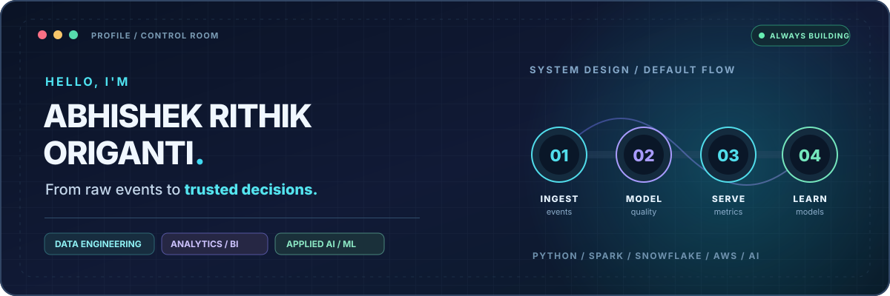
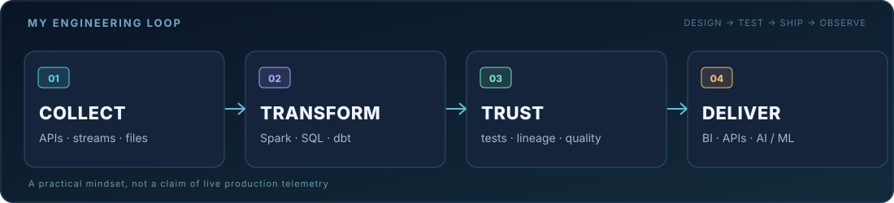

  

  <a href="https://abhioriganti.github.io/"><strong>🌐 Portfolio</strong></a> &nbsp;·&nbsp;
  <a href="https://www.linkedin.com/in/abhishek-rithik-origanti/"><strong>💼 LinkedIn</strong></a> &nbsp;·&nbsp;
  <a href="mailto:abhishekoriganti@gmail.com"><strong>✉️ Email</strong></a> &nbsp;·&nbsp;
  <a href="https://github.com/abhioriganti?tab=repositories"><strong>⌘ Explore repositories</strong></a>

### `> whoami`

I'm **Abhishek**, a data engineer and M.S. Data Science graduate from the **University of Maryland, College Park**. I enjoy turning messy, disconnected data into reliable pipelines, useful analytics, and AI-powered applications.

I work across the stack: **Python and SQL → Spark and dbt → Snowflake and AWS → dashboards, APIs, and ML**. My experience includes data engineering and reporting work with the **University of Maryland Counseling Center**, alongside independent projects in streaming analytics, financial risk, and applied AI.

**Currently exploring:** Data Engineering · Analytics Engineering · Applied ML / AI · Cloud Data Platforms  
**Open to:** Data engineering, analytics engineering, and data science opportunities in the U.S. · Relocation

---

### `> inspect --featured-projects`

| System / repository | The engineering story | Stack |
| :--- | :--- | :--- |
| **[⚡ CryptoPulse](https://github.com/abhioriganti/cryptopulse-bitcoin-data-engineering-power-bi-analytics)** | Bitcoin market-data pipeline from ingestion and streaming transformations to validated analytics and a Power BI semantic model. Includes replay and local benchmarking workflows. | `Redpanda` `PySpark` `Delta` `dbt` `Power BI` |
| **[📈 DerivLens](https://github.com/abhioriganti/DerivLens)** | Derivatives risk analytics platform with Bronze/Silver/Gold data layers, volatility models, VaR/CVaR, and API-based serving. | `Python` `AWS` `Snowflake` `PostgreSQL` `FastAPI` |
| **[🧭 TravelOpsIQ](https://github.com/abhioriganti/travelops-iq)** | Governed travel-operations analytics with a tested Snowflake/dbt modeling layer, ThoughtSpot dashboards, and a read-only MCP interface. Core domain data is synthetic. | `Snowflake` `dbt` `ThoughtSpot` `Python` `MCP` |
| **[🏦 StrataCredit](https://github.com/abhioriganti/StrataCredit)** | Loan-level credit analytics workbench: quality gates, analytical tables, stress scenarios, model experiments, and reproducible reports. | `DuckDB` `Parquet` `scikit-learn` `MLflow` `Streamlit` |

<b>More things I've built — applied AI, ML & research</b>

- **[SafeSim](https://github.com/abhioriganti/Safesim)** — research prototype for medical-text simplification with entity checks and a neuro-symbolic verification layer; **not a clinical tool**.
- **[AV Safety Forecasting](https://github.com/abhioriganti/av-safety-forecasting)** — Transformer-based trajectory forecasting with weakly supervised risk labeling.
- **[No-Show Prediction](https://github.com/abhioriganti/noshow-prediction-umd)** — appointment no-show risk research using **synthetic data**, with tiered reminder recommendations.
- **[TravelGenie](https://github.com/abhioriganti/TravelGenie)** — agentic trip planning using Claude and specialized MCP tools.

---

### `> cat engineering-philosophy.md`

  

**A few rules I build by:**

- **Make data trustworthy before making it pretty.** Tests, clear grains, lineage, and reproducible transformations come first.
- **Make systems explainable.** Good documentation and measurable trade-offs beat impressive-looking black boxes.
- **Connect engineering to outcomes.** Pipelines matter because someone can act on the information they deliver.
- **Keep experimenting.** Streaming systems, cloud platforms, and AI tooling are all part of my learning loop.

---

### `> ls ~/toolbox`

| Layer | Tools I work with |
| :--- | :--- |
| **Code & querying** | Python · SQL · PySpark · R · Scala |
| **Pipelines & modeling** | Apache Spark · Databricks · Delta Lake · dbt · Airflow · Kafka · Redpanda |
| **Warehouses & storage** | Snowflake · PostgreSQL · AWS S3 · Redshift · Parquet |
| **Cloud & delivery** | AWS Glue · Lambda · EMR · Docker · Terraform · GitHub Actions · FastAPI |
| **Analytics & AI** | Power BI · Tableau · scikit-learn · MLflow · LangChain · RAG · LLM applications |

### \`> monitor --github-activity\`

  
  

  

  
   
  Automatically updated from public GitHub activity. Cards may be cached; profile views count page hits, not unique visitors.

---

### `> list --credentials`

| Certified in | Credential |
| :--- | :--- |
| ☁️ **AWS** | [AWS Certified Solutions Architect – Associate](https://www.credly.com/badges/5c0202db-b71d-4b55-b3c9-914995b71cd4/linked_in_profile) |
| 🧱 **Databricks** | Databricks Certified Data Engineer Professional |
| 📊 **Microsoft** | Microsoft Certified: Power BI Data Analyst Associate |

---

### `> connect --human`

I'm always interested in conversations about reliable data platforms, analytics engineering, and practical AI. Whether it's an interesting system design problem, a project collaboration, or a role where I can contribute, I'd love to connect.

  <a href="https://www.linkedin.com/in/abhishek-rithik-origanti/">LinkedIn</a> &nbsp; • &nbsp;
  <a href="https://abhioriganti.github.io/">Portfolio & résumé</a> &nbsp; • &nbsp;
  <a href="mailto:abhishekoriganti@gmail.com">Email</a>

  Built with curiosity, tested with evidence. · © Abhishek Rithik Origanti

